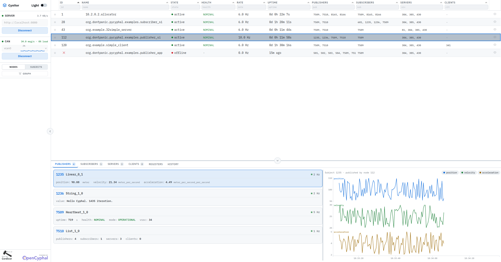
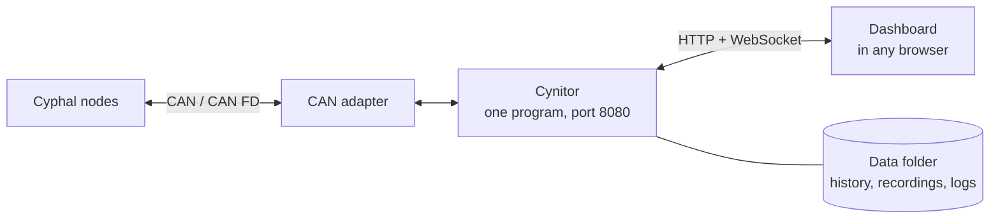

# Cynitor

[](https://github.com/OpenCyphal-Garage/cynitor/actions/workflows/test.yml)

, type check, integration, browser end-to-end")

")
[](https://github.com/OpenCyphal-Garage/cynitor/releases/latest)

A dashboard for [Cyphal](https://opencyphal.org/) (UAVCAN) networks on CAN and
CAN FD. Cynitor watches the bus in real time, lists every node it finds, and
lets you inspect, plot and record what they publish, call their services and
edit their registers. A GUI alternative to
[yakut monitor](https://github.com/OpenCyphal/yakut).

**[Download the latest release](https://github.com/OpenCyphal-Garage/cynitor/releases/latest)**
· [all releases and their notes](https://github.com/OpenCyphal-Garage/cynitor/releases)



*The [demo nodes](#try-it-without-hardware) in the Nodes view.*

## How it works



Cynitor is one program: it talks to the CAN adapter and serves the dashboard.
The machine on the bus needs nothing else, and whoever looks at it needs only
a browser.

## Install

### From a release

No Python needed. Take the file for your system from the
[latest release](https://github.com/OpenCyphal-Garage/cynitor/releases/latest):

| System | File | Then |
|---|---|---|
| Debian, Ubuntu | `cynitor-server_<version>_amd64.deb` | `sudo dpkg -i` it, then run `cynitor-server` |
| Other Linux | `cynitor-server-<version>-x86_64.AppImage`, or the bare binary, `cynitor-server-<version>-linux-x86_64` | `chmod +x` it, then run it |
| Windows 10, 11 | `cynitor-server-<version>-windows-x86_64.exe` | Run it from a terminal |

- All of them are for x86-64, hold the same server and open no window: you
  use it from a browser.
- To change how it starts without a command line (to listen on the network,
  or open a bus at start), use its [settings file](#settings-file).
- An AppImage needs FUSE. Where there is none (a container, a minimal
  install), run it with `--appimage-extract-and-run`.
- Each file has a `<file>.sha256` beside it: `sha256sum -c <file>.sha256`
  checks a download. From 1.4.0 each is also signed as built by this
  repository's release workflow:
  `gh attestation verify <file> --repo OpenCyphal-Garage/cynitor`.
- The licences of the third-party code inside are in the release's
  `*.THIRD-PARTY-NOTICES.txt`, and the versions in `*.requirements.txt`.
- The Linux builds are made on Ubuntu 22.04 and run on it and anything newer.
- The Windows build includes what CANable (candleLight) adapters need. PEAK,
  Kvaser, Vector and IXXAT adapters need their vendor's driver. Windows may
  warn about an unrecognised app the first time, as the executable is not
  code-signed.
- Cynitor asks GitHub once a day whether a newer release is out. If one is, a
  pill by the version under the sidebar links to it, and the dashboard says so
  once, in a notice. Nothing about you or the bus is sent.
  `--no-update-check` (or `CYNITOR_NO_UPDATE_CHECK=1`) turns it off; without
  internet access it fails quietly.

### From source

```bash
git clone --recurse-submodules https://github.com/OpenCyphal-Garage/cynitor.git
cd cynitor/server
pip install -r requirements.txt
python3 main.py
```

Needs Python 3.10 or newer. The submodule holds the standard DSDL types:
without it Cynitor starts but decodes nothing.
`git submodule update --init --recursive` fetches it into a clone made without.

The examples below say `cynitor-server`; from source, that is `python3 main.py`
in `server/`.

## Connect

1. Start Cynitor. It prints its address, `http://127.0.0.1:8080/` by default.
2. Open the address in a browser and click **Connect**.
3. Pick the CAN interface and click the second **Connect**.

Every adapter but SocketCAN also needs the bus bitrate. The list starts
unselected, because a wrong guess disrupts the bus, and remembers what you
last used on each adapter. An adapter that is not listed goes under
**Other…** (see [CAN adapters](#can-adapters)).

To connect at startup instead, name the interface:
`cynitor-server --can can0`. Either way, the dashboard can disconnect and
connect to another interface without restarting Cynitor.

### Try it without hardware

Pick **Simulated bus (no hardware)** in the CAN list, or start with
`cynitor-server --can sim:classic` (`sim:fd` for CAN FD). It is a bus inside
Cynitor, on every system and in the release builds too, with demo nodes on
it:

| Try | What it shows |
|---|---|
| Node 50 (`demo.sensor`), subject 1620 | A temperature named in the node's registers: decoded and plotted |
| **Subjects**, subject 1700 | A velocity no register names: click it and Cynitor guesses its type |
| The log panel, at the right edge | Diagnostics every 3 s, at every severity from DEBUG to CRITICAL. Its **+** adds subject 1800, the node's state as text |
| The node's **Servers** tab | Restart restarts it. **Update firmware…** makes it read the file from Cynitor, as a bootloader does |
| The **Test nodes** tab | Nodes of your own beside the demo, publishing what you set |

The same demo nodes run on a bus of your own. On Linux, with Cynitor installed
from source, beside it on a virtual CAN interface:

```bash
sudo ip link add dev vcan0 type vcan && sudo ip link set vcan0 up
python3 tools/demo_nodes.py --iface vcan0
```

Then connect Cynitor to `vcan0`. There the demo takes options:

| Option | What it does |
|---|---|
| `--conflict` | A second node on the same node-ID after 10 s, which Cynitor flags |
| `--node-id 51`, in a second terminal | A second demo: every subject then has two publishers, which the plots and Compare show apart |
| `--fd` | Runs Cyphal/CAN FD. On a SocketCAN interface set up for CAN FD (a new vcan is one on current kernels: `cat /sys/class/net/vcan0/mtu` says 72) the demo does so by itself, as Cynitor does there |

## Features

| Where | What you get |
|---|---|
| **Nodes** | Every node with its state, health, mode, software version, message rate, uptime and ports. Sort, filter, pin favourites, hide offline nodes. Only what needs a look is coloured |
| **Node details** | Click a node: its subjects as live cards, a plot of any numeric field, its services, its registers (read and write), and 30 days of history: restarts, health and mode changes, node-ID conflicts |
| **Subjects** | Every subject and service on the bus, with its type, rate and when it was last seen. A subject whose type no register names can have it guessed from its messages |
| **Services** | Call any service from a form built from its type; the call history survives restarts. Nodes that serve `uavcan.node.ExecuteCommand` get Restart, Factory reset and **Update firmware…**, which serves a `.bin` to the node's Cyphal bootloader |
| **Graph** | The network as a graph of nodes and subjects, with live traffic on its links |
| **Compare** | Any series side by side, in independent graphs: derived series (delta, ratio, moving average, min/max, rate of change), thresholds, markers, drawings, synced crosshairs, export and import |
| **DSDL** | Every loaded type in a searchable tree, marked when it is seen on the bus. Create, edit and compile your own types |
| **Record** | Record chosen subjects, services and nodes, up to a time or a number of events; save the last N seconds; export CSV or JSONL; replay a recording through the dashboard. Raw CAN logs in candump format, which python-can, SavvyCAN and can-utils read, play back as if they were the live bus |
| **Test nodes** | Nodes of your own on the bus, to test a dashboard, a controller or Cynitor against: a name, a node-ID (yours, or a free one Cynitor gives it), health and mode (changed as it runs), and up to eight publishers of any compiled type, your own DSDL included, at up to 100 messages a second. Every number in a message is a constant or a sine, ramp or square wave, noise, or a count. Their registers name what they publish, so Cynitor decodes it at once. They run on the simulated bus at a click, and on a real bus once you confirm, with a free node-ID and at most 1000 messages a second in all; all stop when CAN disconnects. They are marked *test* in the node table and the graph |
| **Debug** | The bus's health, transport diagnostics, and a raw CAN frame monitor |
| **Log panel** | One timeline of `uavcan.diagnostic.Record` messages, any text subject you add, and Cynitor's own log, timed to the millisecond and filtered by severity and text. Shut, it counts the warnings and errors that came since; what it lists saves to a file |

Cynitor also gives plug-and-play nodes their node-IDs if you ask it to, for a
bus with no allocator of its own: tick **Node-ID allocator** before connecting,
or start it with `--allocator`. It is off otherwise, as a bus may have one
allocator only. It has a dark and a light theme, reconnects by itself, keeps
your layout in the browser, and needs no internet access.
[website/README.md](website/README.md) describes every view in full.

## CAN adapters

What each system was tested on is in the badges at the top.

| System | Adapters the dashboard finds |
|---|---|
| **Linux** | SocketCAN interfaces: `can0`, `vcan0`, `slcan0`, … |
| **Windows** | PEAK, Kvaser, Vector and IXXAT through their vendor drivers; CANable with candleLight firmware over USB, or with slcan firmware by its serial port |
| **macOS** | Takes the same path as Windows, but `requirements.txt` installs the USB packages for candleLight adapters on Windows only |

An adapter that is not found can be named, with `--can` or under **Other…**:

| Adapter | Name | CAN FD |
|---|---|---|
| SocketCAN (Linux) | `can0`, `vcan0`, `slcan0`, … | When the interface is set up for it |
| PEAK | `pcan:PCAN_USBBUS1` | Yes |
| Kvaser, Vector, IXXAT | `kvaser:<channel>`, `vector:<channel>`, `ixxat:<channel>` | Yes |
| CANable, candleLight firmware | `gs_usb:0`. On Linux it is a SocketCAN interface | If its firmware does CAN FD; a CANable 1.0's does not |
| CANable, slcan firmware | `slcan:COM5@115200`. On Linux, `slcan:/dev/ttyACM0` with no `slcand` attached | CANable 2.0, at 2 or 5 Mbit/s only |
| Anything else python-can drives | `<interface>:<channel>`; from the dashboard only if the server runs with `--allow-any-interface` | No |
| The [simulated bus](#try-it-without-hardware), no hardware | `sim:classic`, `sim:fd`; listed on every system | `sim:fd` |

A name with a `:` in it is passed on as it is, without being checked against
what was found. The older `pythoncan:pcan:PCAN_USBBUS1` spelling still works.

SocketCAN and the adapters Cynitor opens itself differ in a few ways:

| | SocketCAN | Every other adapter |
|---|---|---|
| Bitrate | Set with `ip link`; `--bitrate` is ignored | You give it, and it has to match the bus |
| CAN FD | Follows the interface | You give the data bitrate |
| Bus load | From `canbusload` (`sudo apt install can-utils`) | Measured by Cynitor |
| Error counters, error-passive and bus-off state | Shown | Not available |
| Other programs on the adapter | Fine | No: stop other CAN tools first |

There is no default bitrate: a node that joins at the wrong speed floods the
bus with error frames.

### CAN FD

- **SocketCAN:** set the interface up for CAN FD before you connect, and
  Cynitor follows it. The interface has to be down for the change:

  ```bash
  sudo ip link set can0 down
  sudo ip link set can0 type can bitrate 500000 dbitrate 2000000 fd on
  sudo ip link set can0 up
  # a vcan is CAN FD as made on current kernels (mtu 72); to switch one to it:
  sudo ip link set vcan0 down && sudo ip link set vcan0 mtu 72 && sudo ip link set vcan0 up
  ```

- **Every other adapter:** give the data-phase bitrate, with `--data-bitrate`
  or under the bitrate in the dashboard, which offers it where the adapter
  can run CAN FD:

  ```bash
  cynitor-server --can gs_usb:0 --bitrate 1000000 --data-bitrate 4000000
  ```

  For PEAK and candleLight adapters the bit timing aims at an 80 % sample
  point in both phases.

Every node on a CAN FD bus has to run CAN FD: Cynitor sends CAN FD frames
there, which a Classic-only controller answers with error frames.

### Cyphal v1.1

Cynitor speaks Cyphal v1.0. Cyphal v1.1 (in draft) uses a frame format v1.0
does not have, so a v1.1 device would just look silent. Cynitor notices that
traffic and says so under the CAN status: which nodes send it, and on hover
how much, and on which subject-IDs. To see such a device's data, pin its
topics to v1.0 subject-IDs on the device (`name#1234`).

## Options

| Flag | Effect |
|---|---|
| `--can <name>` | Connect at startup. Without it, or if the name does not exist, you pick the interface in the dashboard. `sim:classic` and `sim:fd` are the [simulated bus](#try-it-without-hardware) |
| `--bitrate <n>` | Bus speed in bit/s. Required with `--can` for every adapter but SocketCAN and the simulated bus |
| `--data-bitrate <n>` | CAN FD data-phase speed in bit/s; leave it out for Classic CAN. Ignored for SocketCAN |
| `--decode-on-demand` | Decode only the subjects a dashboard shows or a recording takes, and count the rest: for a bus that carries more than the server can decode. The dashboard's **Decode on demand** box does the same at any time |
| `--no-commands` | Watch the bus and read its nodes, but change none: register writes, service calls, firmware updates and test nodes on a real bus are refused, and no allocator runs. The server enforces it, so no dashboard or script can get round it. The dashboard's **No commands** box does the same for one session |
| `--listen-only` | Watch the bus without sending anything: no node-ID, heartbeat or requests, so node names, versions and registers are not read. The dashboard's **Listen only** box does the same for one session. The CAN controller still acknowledges frames unless the interface itself is in listen-only mode (SocketCAN: `ip link set can0 type can ... listen-only on`); an adapter Cynitor opens itself (gs_usb, PCAN, … on Windows) always acknowledges, as a node with no other on the bus needs an acknowledgement to stop resending |
| `--allocator` | Give plug-and-play nodes their node-IDs. Off by default: only for a bus with no allocator of its own. The dashboard's **Node-ID allocator** box does the same for one session |
| `--bind <host>` | Listen on `<host>`. Default `127.0.0.1`; `0.0.0.0` for the whole network, which needs `CYNITOR_AUTH_TOKEN` set |
| `--insecure-no-auth` | Allow a `--bind` beyond loopback without a token, on a network you trust |
| `--allow-any-interface` | Let the dashboard open any python-can interface, not only the CAN adapters Cynitor knows |
| `--no-update-check` | Do not ask GitHub whether a newer release is out |
| `--reconnect` | With `--can`: attach to it again whenever its session ends (an adapter unplugged, a bus fault), waiting 5 s, then longer, up to a minute. Without it, `/api/health` answers 503 while that bus is down, for a supervisor to see |
| `--access-log` | Log every HTTP request; off by default, as a dashboard makes a few a second |
| `--port <n>` | Listen on `<n>`. Default 8080 |
| `--data-dir <dir>` | Keep the data in `<dir>` |
| `--no-frontend` | Serve only the API and the WebSocket, not the dashboard |
| `--recompile` | From source: compile the DSDL types again |
| `--config <file>` | Read the settings from `<file>` (see [Settings file](#settings-file)) |
| `--write-config [<path>]` | Write a settings file, every setting commented out, to `<path>` (a file or a folder; default: the data folder), and exit |
| `--version` | Print the version and exit |

And from the environment:

| Variable | Effect |
|---|---|
| `CYNITOR_AUTH_TOKEN` | The token the API and the event stream then ask for |
| `CYNITOR_DATA_DIR` | The same as `--data-dir` |
| `CYNITOR_CONFIG` | The same as `--config` |
| `UAVCAN__NODE__ID` | Cynitor's own node-ID. Without it, Cynitor listens to heartbeats on each connect and takes 127, else 126 (the two Cyphal leaves to tools, which allocators never give out), else another free one |

### Settings file

Every option can also be set in a `cynitor.toml`, for a Cynitor started
without a command line, such as a double-clicked `.exe` or AppImage. The
settings are named as the options are, without the `--`:

```toml
bind = "0.0.0.0"
auth-token = "a-long-random-value"
can = "pcan:PCAN_USBBUS1"
bitrate = 1000000
reconnect = true
```

- Cynitor reads the file `--config` (or `CYNITOR_CONFIG`) names, else a
  `cynitor.toml` next to the executable (next to the `.AppImage` file, for an
  AppImage), else the one in the [data folder](#where-data-is-kept).
- On the first start it writes one to the data folder, with every setting
  listed and commented out: take out the `#` in front of one to set it, and
  restart. `--write-config <path>` writes one anywhere else, next to the
  `.exe` say. Either is readable by its owner only, as it may hold the token.
- The command line overrides the file, and so does the environment:
  `auth-token`, `dev-origins`, `node-id` and `data-dir` stand for
  `CYNITOR_AUTH_TOKEN`, `CYNITOR_DEV_ORIGINS`, `UAVCAN__NODE__ID` and
  `CYNITOR_DATA_DIR`. A relative `data-dir` is taken from the file's folder.
  A Windows path goes in single quotes, `'D:\Cynitor data'`, as TOML reads a
  backslash in double quotes as an escape.
- The startup log names the file it used. A setting it does not know, or a
  value it cannot take, stops the start with the reason.
- The systemd service keeps its settings in `/etc/default/cynitor-server`
  ([As a service](#as-a-service)), and is written no file.

## Where data is kept

One folder, whatever folder Cynitor is started from. The startup banner shows
which:

| System | Data folder |
|---|---|
| Linux | `~/.local/share/cynitor` (`$XDG_DATA_HOME/cynitor`); `/var/lib/cynitor` for the systemd service |
| Windows | `%LOCALAPPDATA%\Cynitor` |
| macOS | `~/Library/Application Support/Cynitor` |

It holds bus history (24 h), node history (30 days), service-call history,
recordings, device names, the types you set for subjects, the test nodes you
make, and the [settings file](#settings-file), `cynitor.toml`. Raw CAN logs are in `raw/`, firmware files in `firmware/`, your DSDL
types in `dsdl/`.

Earlier versions wrote next to where Cynitor was started. Data found there is
moved in once, on the first start, and never overwrites what the data folder
already has. Custom DSDL types in a source tree's `dsdl_messages/custom/` are
copied in on the first start.

## Use it from another machine

```bash
CYNITOR_AUTH_TOKEN=$(openssl rand -hex 24) cynitor-server --bind 0.0.0.0
```

Open `http://<that-machine>:8080`: the dashboard asks for the token once and
remembers it. Started without a command line, set `bind` and `auth-token` in
its [settings file](#settings-file) instead.

- **A token is needed to bind beyond loopback.** Without one, anyone who can
  reach the port can command the nodes on the bus, so Cynitor refuses to start
  that way unless `--insecure-no-auth` says the network is trusted.
- It is plain HTTP: beyond a trusted network, put a TLS reverse proxy in front.
- Cynitor prints the token on the terminal at startup and keeps it out of its
  log, so it does not end up in the system journal.
- The token protects the API and the event stream. The dashboard's own files
  are served without it, as a browser has to load the page before it can ask.
- Pages of other websites cannot use the API through your browser (see the
  browser origin policy in [WEBSOCKET_README.md](WEBSOCKET_README.md)).
- With `--no-frontend` Cynitor serves only the API, for your own tooling.

### As a service

The `.deb` installs a systemd unit, disabled by default. Set its options in
`/etc/default/cynitor-server`, with `CYNITOR_AUTH_TOKEN` before it binds
beyond loopback, then:

```bash
sudo systemctl enable --now cynitor-server
```

The unit does not run as root: systemd gives it a user of its own
(`DynamicUser`), in the `dialout` group for slcan adapters, which can write
only to `/var/lib/cynitor`. SocketCAN needs nothing more. An adapter that
needs other device access (a vendor driver's device files) needs a drop-in
that grants it, made with `sudo systemctl edit cynitor-server`.

## Troubleshooting

This section is written for Linux, where the bus is a SocketCAN interface: the
commands it names (`ip link`, `yakut` on a `vcan` or `can0`, `can-utils`) are
Linux tools. The rows that name none of them hold on every system.

| What you see | What to do |
|---|---|
| No nodes | Check that something publishes: `yakut sub uavcan.node.Heartbeat.1.0`. A `vcan` is empty until something publishes on it, such as the [demo nodes](#try-it-without-hardware), which the simulated bus has of its own |
| The server's CPU reading is near 100 %, or messages are counted as dropped | The bus carries more than one core can decode. Tick **Decode on demand** under the server's Connect button: only the subjects whose values are on screen or being recorded are then decoded, and the rest are counted, so their rates still show. History and "save the last N seconds" then hold only what was decoded |
| A node with no name and no registers | Its heartbeats reach Cynitor, but Cynitor's requests do not reach it. On a CAN FD bus the usual cause is a node running Classic CAN: run every node in CAN FD, or set the interface to Classic CAN |
| CAN will not connect | Check that the interface exists (`ip link show can0`) and that you may open it. The log panel's Server source and stderr have the full error |
| Bus load stays at 0 % on SocketCAN | Install `can-utils` |
| CAN FD bus load reads low on SocketCAN | `canbusload` from before mid-2021, such as Ubuntu 22.04's, counts Classic CAN frames only |
| **Server Unavailable** over the page | Cynitor stopped. Start it again and the page reloads by itself |
| Port 8080 is taken | `--port 9099`, or any free port |

## Documentation

- [website/README.md](website/README.md): the dashboard, view by view, and
  how to serve it separately while you edit it.
- [WEBSOCKET_README.md](WEBSOCKET_README.md): the REST and WebSocket API.
- [TECHNICAL.md](TECHNICAL.md): architecture, tests, building the binaries
  yourself, and how releases are made.
- [Releases](https://github.com/OpenCyphal-Garage/cynitor/releases): downloads
  and notes for every version.
